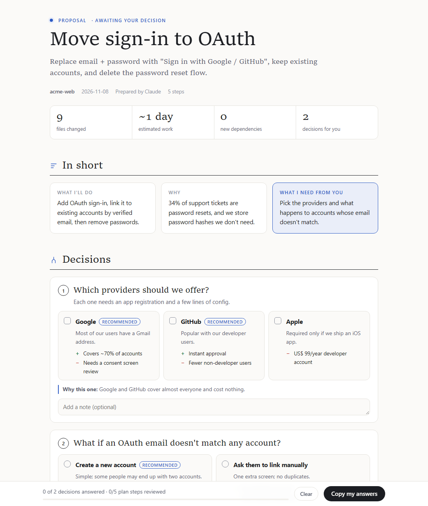
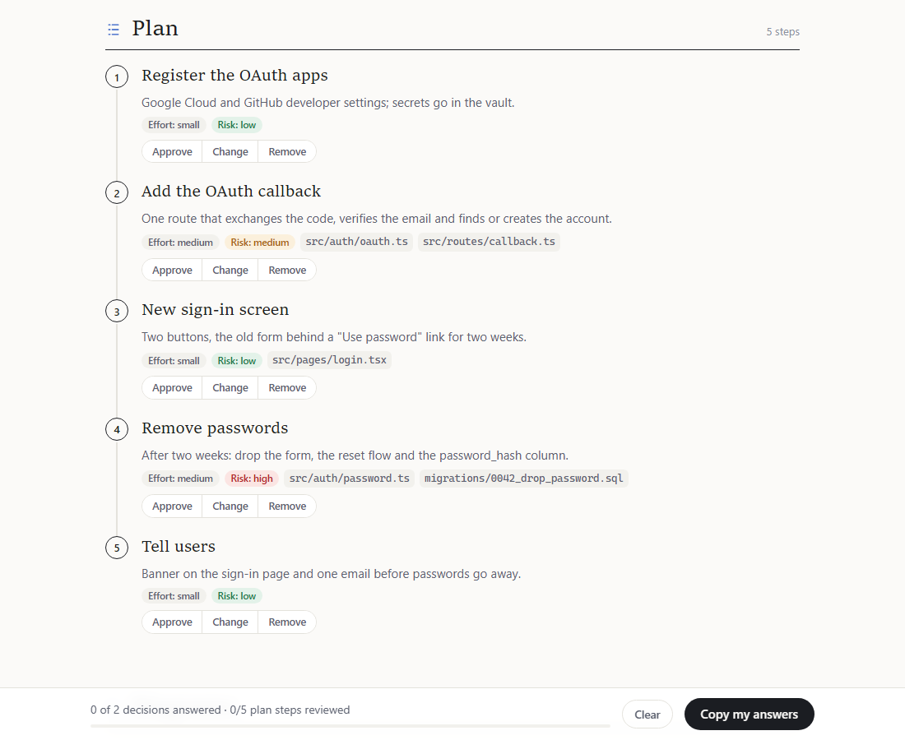
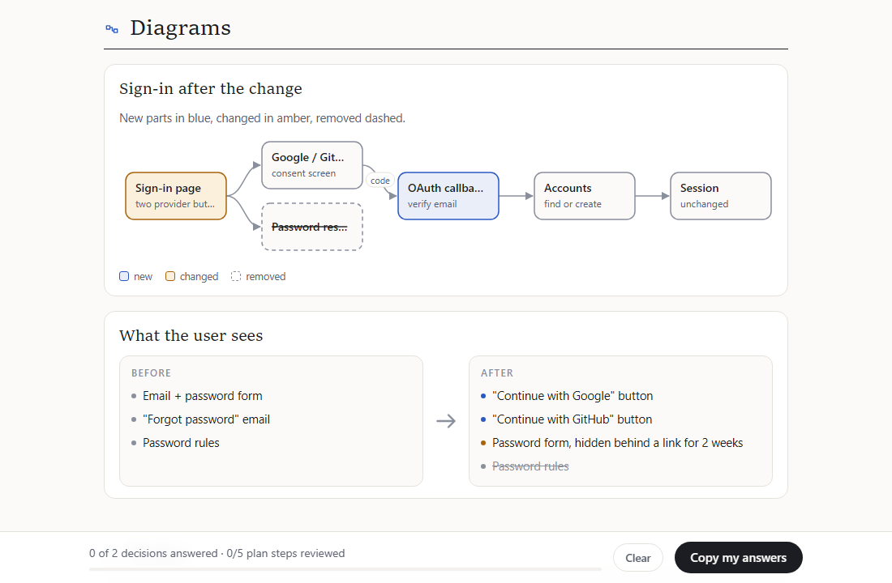
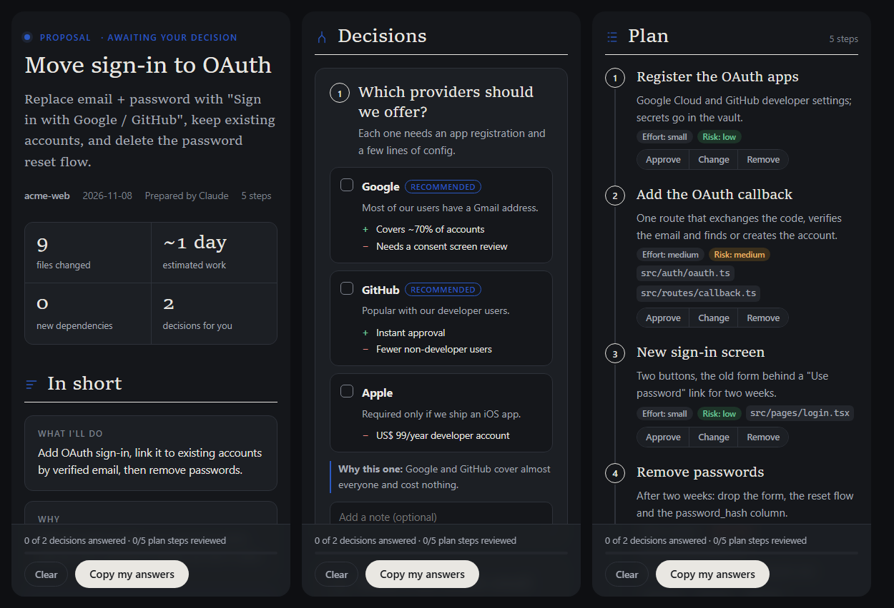

# /proposal

**Stop scrolling through walls of AI text to find the one question it asked you.**

`/proposal` is a skill for [Claude Code](https://claude.com/claude-code) that turns the AI's plan into a
clean one-page proposal: what it wants to do, the decisions it needs from you (with its recommendation),
the steps, a diagram or two, and the risks. You click your answers right on the page, press
**Copy my answers**, paste them into the chat, and the AI carries on.

**[See a live example →](https://diegorezm.github.io/proposal-skill/examples/oauth.html)**



## Why

Plans written in a chat are hard to review. The decisions hide in the middle of paragraphs, it's
easy to miss a risk, and answering means retyping half the context ("about the second thing you
said…"). A proposal page fixes the conversation in both directions:

- **The AI has to be clear.** It must name the real decisions, give options with pros and cons, pick
  one and say why, and keep every sentence short.
- **You review in a minute.** Everything has its place, so you scan, click and comment.
- **Your answer is precise.** The copied reply says exactly which option you chose for each decision and
  what to change in each step, so nothing gets lost.

## What's on the page

| Section | What you do there |
| ------- | ----------------- |
| **In short** | Read what the AI will do, why, and what it needs from you. |
| **Decisions** | Pick an option for each question (or several, when allowed). The recommended one is marked, with the reason. Add a note if you want. |
| **Plan** | See each step with its effort, risk and the files it touches. Mark it **Approve**, **Change** (and say what) or **Remove**. |
| **Diagrams** | See how the parts connect (new parts in blue, changed in amber, removed dashed) or a before → after comparison. |
| **Risks** | Each risk with its level and how the AI plans to reduce it. |
| **Anything else?** | What's out of scope, questions the AI couldn't answer, links, and a box for your general comments. |

A bar at the bottom shows how many decisions you've answered, and the **Copy my answers** button turns
everything into a short reply.





It also has a dark theme and works on a phone:



## The answer you paste back

After clicking a few options, **Copy my answers** gives you something like this:

```markdown
## Answers to the proposal: Move sign-in to OAuth

### Decisions
1. Which providers should we offer? → **Google**, **GitHub**
2. What if an OAuth email doesn't match any account? → **Ask them to link manually** (not the recommendation)
   > we had complaints about duplicate accounts last year

### Plan
- Step 4 "Remove passwords": **Change** — keep passwords for admins
- Approved steps: 1, 2, 3, 5

### General note
Start after Friday's release.
```

Paste it into the chat. The AI follows your choices (including the ones that went against its
recommendation), changes or drops the steps you marked, and either starts working or shows you an
updated proposal. Prefer typing? Answering in plain chat works too.

## Install

**As a plugin** (inside Claude Code):

```
/plugin marketplace add diegorezm/proposal-skill
/plugin install proposal@proposal-skill
```

**Or copy the folder**: put `skills/proposal/` in `~/.claude/skills/` to use it in every project, or in
`.claude/skills/` inside a single project.

You need Python 3.8 or newer for the renderer (no packages to install). Without Python, the skill
tells the AI how to fill in the page by hand.

## Use it

Type the command with what you want proposed:

```
/proposal move our sign-in to OAuth
/proposal split the billing module into its own service
/proposal how should we redesign the onboarding flow?
/proposal plan the migration from MySQL to Postgres
```

Or just ask for a plan in your own words ("what would you suggest for…?", "give me a proposal for…").
The AI will also reach for it before big or risky changes where it needs several decisions from you.

What happens next:

1. The AI looks into your code, docs or data first.
2. It writes the proposal and opens the page in your browser (or publishes it as an Artifact, when
   your Claude app supports that) and tells you, in one or two lines, what it needs from you.
3. You answer on the page and paste the copied answers back.
4. The AI gets to work, or shows you a revised proposal if your answers changed a lot.

Pages are saved in your system's temp folder, not in your project. Your clicks are remembered in your
browser until you press **Clear**.

## Make it yours

- **Color**: the AI uses your project's brand color when it knows it (`"accent": "#rrggbb"`).
- **Language**: the page's own labels come in English and Brazilian Portuguese, picked from the
  language you're chatting in. To add another, add an entry to `LABELS` in `skills/proposal/template.html`.
- **Rules**: edit `skills/proposal/SKILL.md` to change when the AI proposes and how it writes (for
  example "always include a rollback step").

## How it works

The AI never writes HTML. It writes a small JSON file (title, summary, decisions, steps, diagrams,
risks…), and `render.py` checks it and puts it into a ready-made page. That's why every proposal looks
the same, works the same and never breaks.

```
skills/proposal/
├── SKILL.md        instructions for the AI: when to propose, how to write it, the data format
├── template.html   the page: layout, themes, diagrams and the answer button, drawn from the JSON
├── render.py       checks the JSON and writes one HTML file
└── example.json    a complete proposal that uses every field
```

The page is a single file with no internet access: no libraries, web fonts, analytics or trackers.
You can attach it to an issue, send it to a teammate, or open it offline.

Try the renderer yourself:

```sh
python skills/proposal/render.py skills/proposal/example.json my-proposal.html --open
```

The full data format is documented in [`SKILL.md`](skills/proposal/SKILL.md#2-the-data), and
[`example.json`](skills/proposal/example.json) shows every field in use.

## License

[MIT](LICENSE). Use it, change it, share it.
